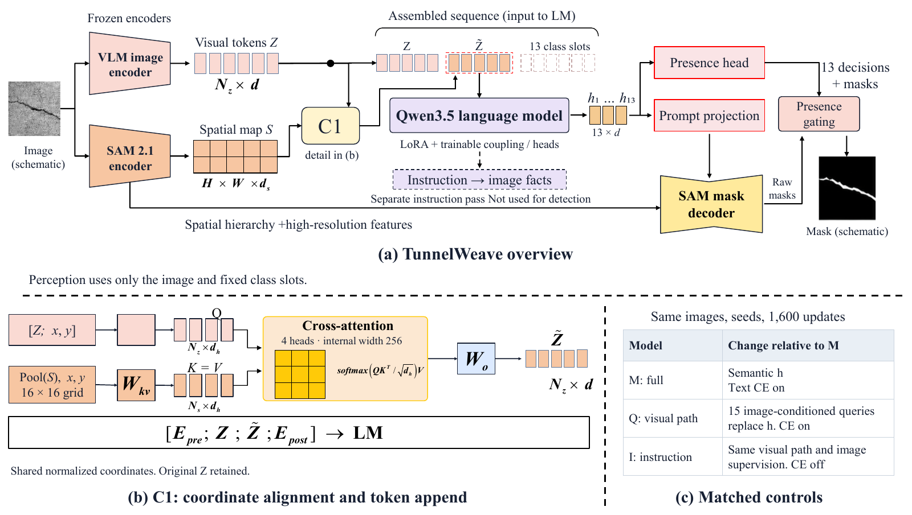

# TunnelWeave

**Bridging Vision–Language Semantics and Pixel Evidence for Autonomous Tunnel Inspection**

## Abstract

Automated tunnel inspection remains constrained by domain shifts, scarce annotated data, and the separation of defect recognition, pixel-level localization, and inspection reporting. We present TunnelWeave, a unified vision–language framework for recognizing thirteen defect categories, segmenting their spatial extent, and generating structured descriptions. Its semantic–spatial coupling module aligns segmentation features with visual-language tokens before language-model processing, allowing category representations to incorporate both contextual semantics and spatial detail. Shared class-query states then guide recognition and mask prediction without manually specified categories or regions. To support domain-specific learning, we construct TunnelInstruct with 1,740 instruction–response pairs and curate a segmentation corpus of over 8,000 images through multi-source integration and pixel-level annotation refinement. TunnelWeave achieves a mean presence-gated intersection over union of 53.52% on fully annotated positive image–class pairs in the validation benchmark and a recognition macro-F1 of 81.86% across seven defect categories on images we collected from real-world tunnel environments. By combining semantic interpretation, pixel-level evidence, and textual reporting, this work supports more informative and automated inspection of rail transit infrastructure.

## Architecture



[Vector version](assets/architecture.pdf)

## Code

TunnelWeave combines **Qwen3.5-9B** and **SAM 2.1 Hiera-L**. Coordinate-aware cross-attention appends spatial features to the visual-language sequence. Shared class states drive thirteen-class recognition and native-resolution segmentation; a separate instruction pass produces structured descriptions.

This repository provides the model, native-pixel supervision, joint training, two ablation switches, checkpointing, image-only inference, and saved-prediction evaluation. The public package is organized as follows:

```text
src/tunnelweave/
  backbone.py, sequence_concat.py  # Qwen–SAM coupling
  model.py, ablations.py           # Shared heads and matched controls
  data.py, losses.py, train.py     # Native labels and joint learning
  checkpoint.py, inference.py      # Resume state and automatic prediction
  descriptions.py, metrics.py      # Structured reporting and evaluation
configs/                          # Backbone and training configurations
tests/                            # CPU mathematical and interface checks
```

### Installation

Use Linux, Python 3.12, and a CUDA-compatible PyTorch environment. The original runtime used PyTorch 2.10.0 (CUDA 12.8), Transformers 5.2.0, and PEFT 0.20.0. Training and full-model inference require substantial GPU memory; the experiments used two A800 GPUs per arm.

```bash
git clone https://github.com/xingxiaoyang-888/Tunnel-Weave.git
cd Tunnel-Weave
python -m venv .venv
source .venv/bin/activate
python -m pip install --upgrade pip
pip install torch==2.10.0 torchvision==0.25.0 --index-url https://download.pytorch.org/whl/cu128
pip install -e ".[data,test]"
pip install "git+https://github.com/facebookresearch/sam2.git@2b90b9f5ceec907a1c18123530e92e794ad901a4"
```

Download the official backbones, then update `configs/model.json` or set `TUNNELWEAVE_QWEN_PATH` and `TUNNELWEAVE_SAM_CHECKPOINT`:

```bash
hf download Qwen/Qwen3.5-9B --revision c202236235762e1c871ad0ccb60c8ee5ba337b9a --local-dir models/Qwen3.5-9B
mkdir -p models
curl -L https://dl.fbaipublicfiles.com/segment_anything_2/092824/sam2.1_hiera_large.pt -o models/sam2.1_hiera_large.pt
```

### Prepare and train

Request access to both datasets below and log in with `hf auth login`. Preparation verifies original asset hashes and retains native masks and valid regions.

```bash
tunnelweave prepare --output data/tunnelweave
torchrun --standalone --nproc_per_node=2 -m tunnelweave.cli train \
  --data data/tunnelweave --output runs/full
```

Use `--arm Q_no_semantic_guidance` for the image-query control or `--arm I_no_instruction_supervision` to disable description CE while retaining visual supervision. Configure the fixed training budget in `configs/train.json`. The default public schedule is a fresh-training recipe; historical curriculum and matched-ablation results are not automatically reproduced by this command. [Implementation details](docs/implementation.md) specify the data, loss, and reproducibility boundaries.

### Inference and evaluation

```bash
tunnelweave infer --checkpoint runs/full/checkpoint-001600 \
  --image example.jpg --output outputs/example --descriptions

tunnelweave infer-dataset --checkpoint runs/full/checkpoint-001600 \
  --data data/heldout --manifest data/heldout/validation.jsonl --output outputs/validation
tunnelweave evaluate --data data/heldout --manifest data/heldout/validation.jsonl \
  --predictions outputs/validation --output outputs/metrics

pytest -q
```

Inference saves thirteen raw and presence-gated masks at the original image resolution. Evaluation reports recognition F1, positive-pair IoU/Dice including misses, full-image/ROI breakdowns, and reliable-region false positives. Supply an annotated held-out manifest for validation; the public datasets are training resources. Trained project checkpoints and held-out benchmark images are not bundled in this source release.

## Datasets

| Dataset | Contents | Access |
|---|---|---|
| [TunnelWeave-Segmentation](https://huggingface.co/datasets/augustusper/TunnelWeave-Segmentation) | 8,889 images, 13 defect categories, native masks and validity metadata | Request access |
| [TunnelInstruct](https://huggingface.co/datasets/augustusper/TunnelInstruct) | 1,740 instruction–response pairs across 1,725 images | Request access |

Both repositories provide category configurations and an `all` configuration. Access requests are reviewed manually. Please retain the source attribution and usage conditions documented in each dataset card. Qwen and SAM remain subject to their respective upstream licenses.
